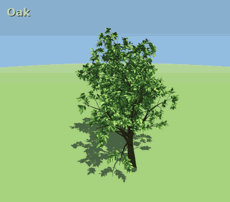
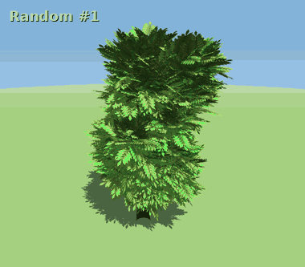
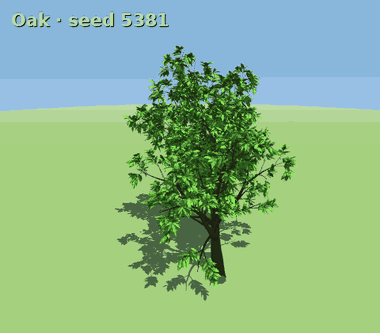
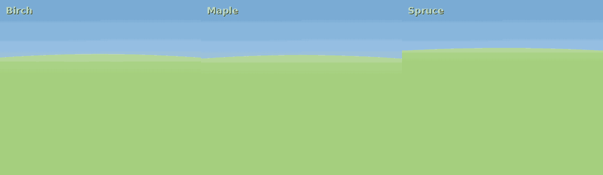

# TreeGen

A procedural 3D tree generator that runs entirely in the browser (three.js, no build step). Every tree is defined by a small "genome" of sliders: trunk, branching, crown shape, leaves, bark, season, and a seed for the individual.

Hosted at [schaugf.github.io/TreeGen](https://schaugf.github.io/TreeGen)

## Run it Locally

Open `index.html` in a browser. Everything it needs is in `vendor/`.

## Presets

Twelve built-in species: Oak, Spruce, Douglas-fir, Birch, Willow, Palm, Acacia, Baobab, Cypress, Juniper, Maple and Sakura. Pick one, then tweak any gene.

## Randomize

**Randomize** samples a new genome from plausible ranges, rejecting anything that doesn't look like a tree. Here are twelve draws:

## One species, many individuals

**New seed** keeps the genes and rerolls the individual. Same species, different tree. This is twelve seeds of Oak:

## Growth simulation

Drag the **age** slider or press **▶ Grow** to watch a tree grow from sapling to maturity. Birch, Maple and Spruce:

## Other controls

- **Mutate** nudges every gene a little.
- **Auto-rotate**, **Screenshot** and **Copy link**. The link encodes the whole genome in the URL hash.
- Drag to orbit, scroll to zoom.

The GIFs in `docs/` were captured headlessly from the app itself with a fixed random seed, so they can be regenerated.
